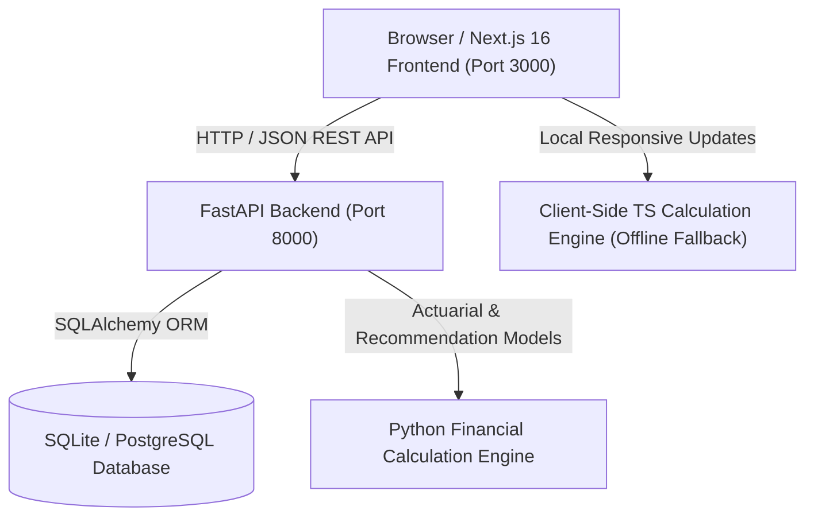

# LifeWise AI — Intelligent Life Insurance Needs Finder & Digital Advisory Platform

LifeWise AI is a full-stack financial technology web application designed to help individuals calculate accurate life insurance coverage and navigate policy choices with complete transparency. Built with an actuarial calculation engine, deterministic category matching, interactive scenario modeling, and digital advisory booking, LifeWise AI bridges the gap between complex insurance mathematics and everyday consumer decisions.

---

## 1. Problem Statement

Insurance buyers in India and globally face persistent structural challenges:
- **Mis-selling & Biased Sales Incentives**: Traditional insurance distribution channels often push high-commission investment-cum-insurance products (such as traditional endowments or opaque ULIPs) to consumers who primarily need affordable pure-risk term life protection.
- **Rule-of-Thumb Guesswork**: Most online calculators use crude heuristics (e.g., "10x annual income") that fail to account for household debt, future inflation, children's higher education milestones, or existing liquid protection assets.
- **Opaque Math**: Policyholders rarely understand how their coverage needs are derived or how inflation erodes living expenses over a 20-to-30 year support horizon.
- **Disconnected Advisory**: After using a generic calculator, users are typically handed over to cold callers rather than certified, fee-only or transparent advisors.

---

## 2. Proposed Solution

LifeWise AI provides an objective, transparent, and user-centric platform that:
1. **Applies Formal Actuarial Methodologies**: Computes true life cover requirements using the **Net Needs Approach** (discounted cash flow of living expenses + liabilities + goals - protection assets) and benchmarks against the **Human Life Value (HLV)** model.
2. **Deterministic Recommendation Engine**: Evaluates user financial profiles against deterministic rules across four major product categories: **Pure Term Life**, **Whole Life Insurance**, **Endowment / Guaranteed Plans**, and **Unit Linked Insurance Plans (ULIP)**.
3. **Interactive Scenario Simulation**: Allows users to test policy durations, coverage amounts, and monthly budgets with real-time affordability feedback.
4. **Seamless Advisory Booking**: Enables direct consultation scheduling with certified protection advisors (CFP® / IRDAI certified).
5. **Privacy-First & Dual-Engine Architecture**: Operates with a client-side TypeScript calculation engine alongside a high-performance Python FastAPI backend, ensuring instant responsiveness with full local offline fallback.

---

## 3. Implemented Features

| Feature | Description | Implementation Status |
| :--- | :--- | :--- |
| **Interactive Landing Page** | Value proposition, 4-step framework, product primers, and live quick-estimator slider. | Implemented (`/`) |
| **4-Step Assessment Wizard** | Multi-step form capturing demographics, family expenses, liabilities, goals, and assets. Includes an instant sample profile loader. | Implemented (`/assessment`) |
| **Net Needs Calculation Engine** | Computes discounted PV of family support with inflation adjustments, liabilities, and liquid asset offsets. | Implemented (`/results`, `/backend/app/financial_engine.py`) |
| **Human Life Value (HLV) Benchmark** | Calculates economic capital value of future earnings to age 60 (net of 30% personal consumption and 5% income growth). | Implemented (`/results`) |
| **Visual Breakdown (Recharts)** | Interactive composition donut charts (Needs vs. Protection) and coverage gap comparative bar charts. | Implemented (`/results`) |
| **Product Recommendation Engine** | Multi-category scoring with fit percentages, key advantages, limitations, and "Questions to Ask Insurers". | Implemented (`/recommendations`) |
| **Interactive Coverage Simulator** | Live sliders for Desired Cover, Duration, and Monthly Budget with real-time affordability indicators and category premium comparisons. | Implemented (`/simulator`) |
| **Advisor Booking Workflow** | Advisor directory (CFP® profiles), real-time date and slot selection (45-min slots), and appointment confirmation. | Implemented (`/advisory`) |
| **Educational Advisor Chat / FAQ** | Interactive question-and-answer assistant addressing common insurance myths, claim settlement ratios, and rider recommendations. | Implemented (`/advisory`) |
| **Compliance & Disclaimers** | IRDAI educational notices and DPDP compliant privacy statement. | Implemented (`/disclaimer`, `/privacy`) |

---

## 4. How the Application Works

### Net Needs Approach Formula
$$\text{Total Needs} = \text{PV of Family Support} + \text{Outstanding Liabilities} + \text{Future Goals}$$
$$\text{Available Protection} = \text{Existing Life Cover} + \text{Eligible Protection Assets}$$
$$\text{Additional Cover Required} = \max(0, \text{Total Needs} - \text{Available Protection})$$

Where the Present Value ($PV$) of family living expenses is calculated using the real rate of return $k$:
$$k = \frac{r - i}{1 + i}$$
- $i = 6.0\%$ (Assumed long-term living expense inflation rate)
- $r = 7.5\%$ (Assumed conservative protection corpus investment return)
$$PV = E \times \frac{1 - (1 + k)^{-T}}{k}$$
*(where $E$ is annual family living support and $T$ is the support duration in years)*

### Human Life Value (HLV) Benchmark
Calculates the economic replacement value of future earnings until retirement age (60):
$$\text{Net Family Income} = \text{Annual Income} \times (1 - c)$$
- $c = 30\%$ (Personal consumption deduction)
- $g = 5.0\%$ (Annual income growth rate)
- $r = 7.5\%$ (Discount rate)

*Note: HLV is presented strictly as a comparative economic benchmark and is never added to Net Needs to prevent double counting.*

---

## 5. Technology Stack

### Frontend
- **Framework**: Next.js 16.4 (App Router with Turbopack)
- **Library**: React 19
- **Language**: TypeScript 5
- **Styling**: Tailwind CSS
- **Data Visualization**: Recharts
- **Icons**: Lucide React
- **Animations / Effects**: Canvas Confetti

### Backend
- **Framework**: FastAPI (Python 3.11)
- **Data Validation & Schemas**: Pydantic v2
- **ORM & Database**: SQLAlchemy with SQLite fallback (`lifewise.db`) / PostgreSQL ready
- **ASGI Web Server**: Uvicorn
- **Testing**: Pytest & Starlette TestClient

---

## 6. System Architecture



---

## 7. Project Folder Structure

```
Lifewise AI/
├── .env.example                  # Environment configuration template
├── .gitignore                    # Git exclusions for dependencies, builds, & DB
├── README.md                     # Comprehensive platform documentation
├── backend/                      # FastAPI Python backend
│   ├── app/
│   │   ├── __init__.py
│   │   ├── config.py             # App settings and CORS configuration
│   │   ├── database.py           # SQLAlchemy engine & session factory
│   │   ├── financial_engine.py   # Actuarial Net Needs, HLV, and recommendation engine
│   │   ├── main.py               # FastAPI application, route handlers, and data seed
│   │   ├── models.py             # Database models (Assessments, Advisors, Appointments)
│   │   └── schemas.py            # Pydantic request and response schemas
│   └── tests/
│       ├── test_api.py           # Integration tests for REST endpoints
│       └── test_financial_engine.py # Unit tests for financial formulas & edge cases
├── docs/                         # Architecture and calculation reference guides
│   ├── CALCULATION_ENGINE.md
│   └── JUDGES_PITCH_GUIDE.md
└── frontend/                     # Next.js frontend application
    ├── public/                   # Static assets & SVG icons
    ├── src/
    │   ├── app/
    │   │   ├── advisory/page.tsx # Advisor booking & consultation selection
    │   │   ├── assessment/page.tsx # 4-step financial needs assessment wizard
    │   │   ├── disclaimer/page.tsx # IRDAI compliance and educational notices
    │   │   ├── privacy/page.tsx  # DPDP Act compliant privacy policy
    │   │   ├── recommendations/page.tsx # Product category comparison & scores
    │   │   ├── results/page.tsx  # Actuarial charts, coverage gap, & HLV summary
    │   │   ├── simulator/page.tsx # Live slider coverage & budget affordability simulator
    │   │   ├── globals.css       # Design tokens & Tailwind utility imports
    │   │   ├── layout.tsx        # Root layout with responsive Navbar and Footer
    │   │   └── page.tsx          # Hero landing page & quick calculator preview
    │   ├── components/
    │   │   ├── Navbar.tsx        # Navigation header
    │   │   └── Footer.tsx        # Site footer with disclaimer links
    │   ├── types/
    │   │   └── index.ts          # Shared TypeScript interfaces
    │   └── utils/
    │       └── calculations.ts   # Client-side mirror calculation engine
    ├── package.json
    └── tsconfig.json
```

---

## 8. Prerequisites

- **Node.js**: `v18.18.0` or higher (Node 20+ recommended)
- **Python**: `3.10` or higher (Python 3.11 tested)
- **Package Managers**: `npm` (frontend) and `pip` (backend)
- **Git**: Installed and configured

---

## 9. Installation and Setup Instructions

### Step 1: Clone the Repository
```bash
git clone https://github.com/BarruHarish/Lifewise-Ai.git
cd Lifewise-Ai
```

### Step 2: Configure Environment Variables
Copy the example configuration file:
```bash
cp .env.example .env
```

### Step 3: Set Up the Backend
```bash
cd backend
python -m pip install fastapi uvicorn sqlalchemy pydantic pytest httpx
```

### Step 4: Set Up the Frontend
```bash
cd ../frontend
npm install
```

---

## 10. Running the Application Locally

### Start Backend API Server
From the `backend` directory:
```bash
python -m uvicorn app.main:app --host 127.0.0.1 --port 8000 --reload
```
- API Base: `http://127.0.0.1:8000`
- Health Check: `http://127.0.0.1:8000/api/health`
- Interactive OpenAPI Docs (Swagger UI): `http://127.0.0.1:8000/docs`
- ReDoc Documentation: `http://127.0.0.1:8000/redoc`

### Start Next.js Frontend Development Server
From the `frontend` directory:
```bash
npm run dev
```
Open **[http://localhost:3000](http://localhost:3000)** in your browser.

---

## 11. Available API Endpoints

| HTTP Method | Endpoint | Description |
| :--- | :--- | :--- |
| `GET` | `/api/health` | Health check verifying service status and DB connectivity. |
| `POST` | `/api/coverage/calculate` | Calculates Net Needs, PV of support, and HLV benchmark. |
| `POST` | `/api/recommendations` | Generates deterministic category matches and fit scores. |
| `POST` | `/api/assessment` | Calculates and persists assessment record in SQLite. |
| `POST` | `/api/scenarios` | Simulates budget affordability and category rate comparisons. |
| `GET` | `/api/advisors` | Retrieves list of certified advisors (CFP® / IRDAI certified). |
| `GET` | `/api/appointments/availability` | Fetches available 45-min consultation slots for a given date. |
| `POST` | `/api/appointments` | Books an advisory session and generates meeting links. |
| `GET` | `/api/appointments/{id}` | Retrieves appointment confirmation details. |

---

## 12. Testing and Validation Status

All backend and frontend validation suites have been executed and verified:

### Backend Pytest Suite
```bash
cd backend
python -m pytest -o "pythonpath=." -v
```
**Status: 12 passed in 1.64s (100% Passing)**
- `test_api.py::test_health` — Passed
- `test_api.py::test_calculate_coverage_api` — Passed
- `test_api.py::test_recommendations_api` — Passed
- `test_api.py::test_advisors_and_appointments` — Passed
- `test_financial_engine.py::test_pv_annuity_basic` — Passed
- `test_financial_engine.py::test_pv_annuity_zero_years` — Passed
- `test_financial_engine.py::test_hlv_basic` — Passed
- `test_financial_engine.py::test_hlv_past_retirement` — Passed
- `test_financial_engine.py::test_net_needs_zero_liabilities` — Passed
- `test_financial_engine.py::test_net_needs_existing_cover_exceeds_needs` — Passed
- `test_financial_engine.py::test_recommendation_engine_pure_term` — Passed
- `test_financial_engine.py::test_illustrative_premium_bounds` — Passed

### Frontend Production Build
```bash
cd frontend
npm run build
```
**Status: Compiled successfully with zero TypeScript or styling errors.** All 8 client routes statically prerendered with Turbopack.

---

## 13. Security and Privacy Considerations

- **Exclusion of Secrets**: The repository strictly excludes environment files (`.env*`), private keys, temporary logs, and SQLite database binaries via `.gitignore`.
- **Placeholder Configuration**: Only safe placeholders are exposed in `.env.example`.
- **Data Minimization**: Personal financial inputs for needs calculations can run entirely client-side or ephemerally via backend endpoints without mandatory user account creation.
- **Regulatory Alignment**: Designed in contemplation of the Digital Personal Data Protection (DPDP) Act guidelines.

---

## 14. Limitations and Future Enhancements

### Current Limitations
- **Illustrative Premiums**: Premium ranges displayed in recommendations and scenario simulations are illustrative actuarial approximations based on representative market benchmarks rather than live insurer underwriting APIs.
- **Medical Underwriting**: The system does not currently incorporate medical history or tele-underwriting risk loadings into initial premium bounds.

### Future Roadmap
- Direct insurer API integration for real-time quotation fetching.
- Integration of video conferencing provider APIs (e.g., Zoom/Google Meet) for advisory sessions.
- Multi-currency and regional inflation index support for international insurance markets.

---

## 15. Compliance Disclaimer

> **IMPORTANT NOTICE**: LifeWise AI provides automated financial calculations, educational estimates, and general category guidance. It does not issue guaranteed insurance quotations, underwrite insurance policies, or provide regulated investment advice. Final premium rates, eligibility, and terms are subject to formal underwriting by licensed insurance carriers under applicable regulatory jurisdictions (e.g., IRDAI in India). Users are strongly encouraged to consult a licensed financial advisor before making binding policy commitments.

---

## 16. Author

- **Developer**: Barru Harish
- **GitHub Repository**: [https://github.com/BarruHarish/Lifewise-Ai](https://github.com/BarruHarish/Lifewise-Ai)